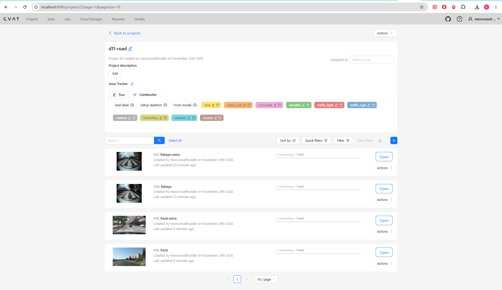
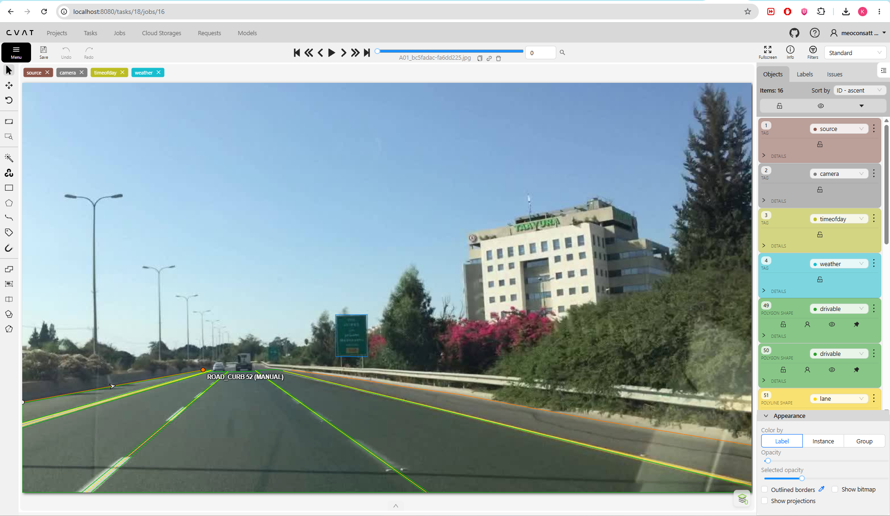
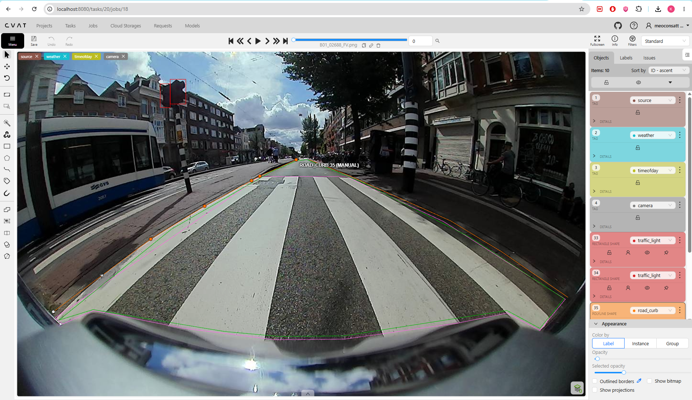
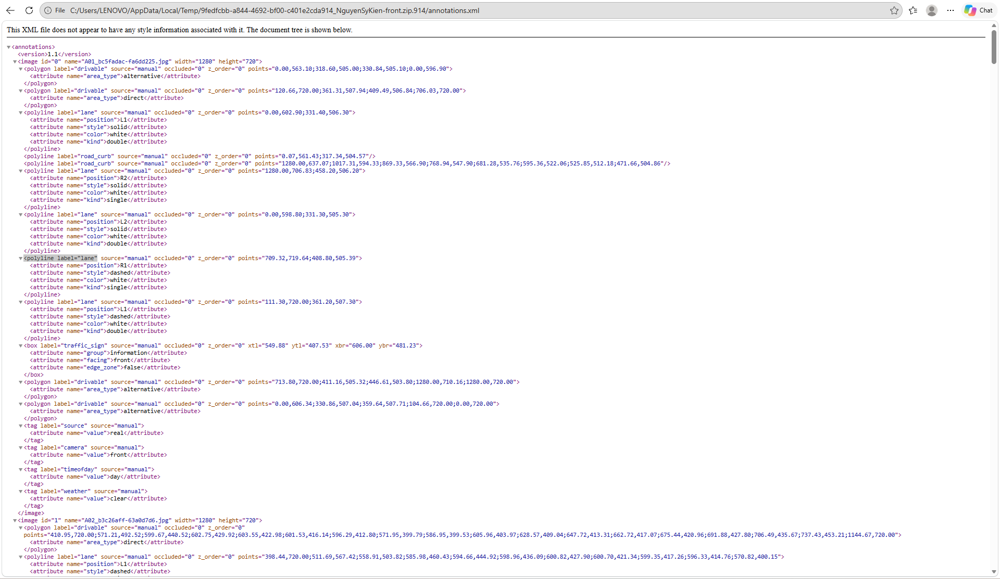

# Báo cáo cá nhân — Ngày 11
Họ tên: Nguyễn Sỹ Kiên               
Mã học viên: 2A202603245  
Phiên bản CVAT (Help → About): CVAT v2.82.0  
Guideline: Road v1.0    Lần nộp (`revision` trong manifest): 1  
Thời điểm export (ngày giờ trên CVAT): 21/11/2026 03:16 UTC+7    Số lần nộp lại sau Rework: 0  

## 1. Kiểm project

| Mục | Đúng như guideline Road v1.0? | Ghi chú |
| :--- | :---: | :--- |
| 6 label, đúng kiểu | Đúng | lane (polyline), road_curb (polyline), crosswalk (polygon), drivable (polygon), traffic_light (box), traffic_sign (box) |
| Thuộc tính và giá trị | Đúng | Khớp 100% với file configs/road_v1_labels.json |
| 4 tag ảnh | Đúng | camera, timeofday, weather, source đều là kiểu Tag với thuộc tính select 'value' |

Cách kết thúc polyline trên bản CVAT này: Bấm phím **N** trên bàn phím.  
Cách đặt tag ảnh trên bản CVAT này: Chọn công cụ Tag ở thanh bên trái, chọn loại tag, sau đó mở bảng Details của Objects để chọn giá trị `value`.  

## 2. Số lượng đã gán

| Task | Ảnh | lane | road_curb | crosswalk | drivable | traffic_light | traffic_sign |
| :--- | :---: | :---: | :---: | :---: | :---: | :---: | :---: |
| front | 12 | 28 | 18 | 9 | 25 | 31 | 44 |
| front-extra (đã làm 4 / 4) | 4 | 17 | 3 | 7 | 10 | 11 | 18 |
| fisheye | 8 | 9 | 30 | 14 | 8 | 7 | 5 |
| fisheye-extra (đã làm 4 / 4) | 4 | 0 | 4 | 4 | 3 | 0 | 1 |

## 3. Bảng ca khó

| Ảnh | Nhãn | Phân vân giữa | Đã chọn | Lý do |
| :--- | :--- | :--- | :--- | :--- |
| A03 | lane | Vẽ dừng trước ô tô che hay nối liền qua | Nối liền qua và bật cờ `occluded` | Quy tắc quy định đoạn bị che ngắn bởi xe/người thì nối liền qua và bật occluded, không dừng trước vật che |
| A04 | lane | Chọn kind single hay double cho vạch vàng | Chọn `kind = double`, `color = yellow` | Vạch phân chia hai chiều xe chạy gồm 2 vạch vàng song song |
| A05 | lane | Có vẽ L1/R1 khi đường không có vạch sơn | Không vẽ L1/R1, chỉ vẽ `road_curb` mép vỉa hè | Đường khu dân cư không có vạch sơn, tuân thủ không vẽ vạch mà ảnh không có (được miễn trừ QC1-02) |
| B05, B06 | lane | Chọn position L1 hay other ở camera bên | Chọn `position = other` | Quy tắc fisheye bắt buộc: camera hai bên hông xe luôn dùng position = other |

## 4. Phiếu QC 1 nhận được
Bạn kiểm lô của tôi: Nguyễn Xuân Anh  Quyết định nhận được: Release  

| Mã lỗi | Số lỗi | Đồng ý? | Đã sửa? |
| :--- | :---: | :---: | :---: |
| QC1-01 | 0 | Đồng ý | Đã rà soát đủ 4 tag trên tất cả các ảnh |
| QC1-03 | 0 | Đồng ý | Đã đảm bảo camera bên hông có position = other |
| QC1-04 | 0 | Đồng ý | Đã đảm bảo polyline vẽ từ gần ra xa |

## 5. Kiểm file export

| File | Mở lại được? | Số shape ảnh 1 (job / file) | Số shape ảnh 2 (job / file) | Tag camera có trong XML? |
| :--- | :---: | :---: | :---: | :---: |
| NguyenSyKien-front.zip | Có | 12 (A01) | 8 (A02) | Có (`front`) |
| NguyenSyKien-fisheye.zip | Có | 6 (B01) | 15 (B02) | Có (`fisheye_front`) |

## 6. Ảnh chụp màn hình

1. **Tab Labels của project:**

2. **Một ảnh camera trước đã gán đủ (A01 - làn, vùng lái, đèn/biển):**

3. **Một ảnh fisheye đã gán, phóng to đoạn polyline cong:**

4. **Một đoạn XML có `<polyline label="lane">`:**

## 7. Tự đánh giá
* **Lỗi bạn mắc nhiều nhất hôm nay (theo mã QC1-xx), và cách tránh ở Ngày 20:**  
  Lỗi dễ mắc nhất là **QC1-01 (tag camera)** và **QC1-03 (position làn trên fisheye)** do thói quen thao tác nhanh: CVAT tự điền giá trị đầu tiên danh sách (`camera=front`, `position=L1`), nếu không mở tab Details kiểm tra kỹ sẽ dễ bị sót. Cách tránh ở Ngày 20: Thiết lập quy trình kiểm tra theo checklist từng bước (tag $\rightarrow$ lane details $\rightarrow$ drivable) ngay sau khi gán từng ảnh trước khi chuyển sang ảnh kế tiếp.

* **Nhãn của bạn đi vào model ở đâu? Chọn một lỗi đã sửa và nói nó làm model học sai thế nào:**  
  Nhãn `lane` (polyline) đi vào bài toán nhận diện làn đường (Lane Detection) phục vụ tính năng giữ làn tự động (LKA - Lane Keeping Assist). Nếu mắc lỗi **vẽ ngược chiều (từ xa về gần)** hoặc **vạch đứt bị cắt vụn thành nhiều polyline**, mô hình học sâu (như kiến trúc Row-Anchor) sẽ xác định sai điểm neo gần xe nhất ở hàng pixel đáy ảnh. Khi đó, vector định hướng làn xe bị lệch góc, khiến hệ thống tính sai vị trí tương đối giữa xe và tâm đường, có thể dẫn đến việc đánh lái lệch hoặc kích hoạt cảnh báo sai nguy hiểm trong thực tế.

## 8. (Tùy chọn, buffer) Từ polyline đến đích row-anchor

| y | 720 | 680 | 640 | 600 | 560 |
| :--- | ---: | ---: | ---: | ---: | ---: |
| x của chúng tôi | 785 | 760 | 738 | 719 | 702 |
| x của bạn kia | 784 | 761 | 739 | 720 | 703 |

Trả lời 3 câu:
1. Năm số x đó chính là đích mà một model row-anchor học cho vạch này. Nếu bạn dừng polyline sớm 40 px, hàng nào đổi thành "không có làn"?  
   $\rightarrow$ Hàng $y = 560$ (hàng xa nhất trên ảnh) sẽ đổi thành "không có làn" do polyline không vươn tới được độ cao đó.
2. So với bạn được kiểm (cùng ảnh): ở hàng 720 và hàng 560, hai bạn lệch nhau bao nhiêu pixel? Lệch ở hàng nào ảnh hưởng LKA nhiều hơn (slide 25)?  
   $\rightarrow$ Ở hàng 720 lệch nhau 1 px ($|785 - 784|$), ở hàng 560 lệch nhau 1 px ($|702 - 703|$). Lệch ở hàng 720 (sát đáy ảnh, gần đầu xe nhất) ảnh hưởng tới LKA nhiều hơn vì đây là căn cứ xác định trực tiếp vị trí lệch tâm (lateral offset) tức thời của xe so với làn đường.
3. Nếu polyline vẽ từ xa về gần (ngược quy tắc 2), cách tính trên có đổi không? Script nào sẽ gặp khó?  
   $\rightarrow$ Cách nội suy $x$ theo các hàng $y$ cố định về mặt hình học không đổi giá trị, nhưng thuật toán duyệt điểm theo thứ tự index sẽ bị đảo chiều. Các script xử lý tuần tự (như script nội suy bezier hay script chuyển đổi format `bdd_to_cvat_road`) sẽ gặp lỗi xác định điểm gốc (anchor point) và chiều tiến của xe.
